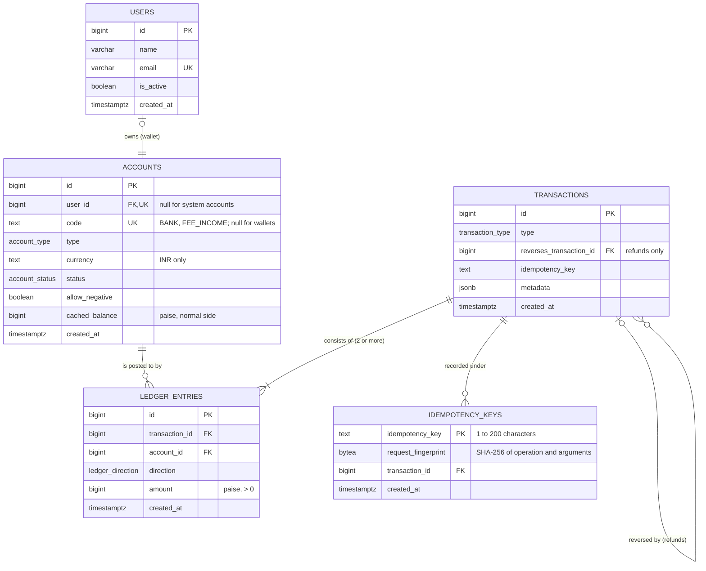

# ER Diagram

Reference version of the ER diagram, matching `db/01_schema.sql` plus the agreed fixes (one wallet per user). Redraw it in draw.io for the report if you prefer Chen notation.

## Reading the relationships

| Relationship | Cardinality | Participation | Notes |
|---|---|---|---|
| User owns account | 1 : 1 | **User: total** (a user is always created with a wallet). **Account: partial** (system accounts have no user). | Enforced by the unique constraint on `accounts.user_id`. |
| Transaction consists of ledger entries | 1 : N (N ≥ 2) | **Both total**: an entry belongs to exactly one transaction, and a transaction has at least two entries. | The "at least 2, balanced" rule is enforced by the deferred trigger in Phase 3, not by the schema. |
| Account is posted to by ledger entries | 1 : N | **Entry: total** (every entry has an account). **Account: partial** (a new account has no entries yet). | |
| Transaction reverses transaction | 1 : N | **Both partial** | One transfer can have several partial refunds. Only refunds set the reference. |
| Transaction is recorded under idempotency keys | 1 : N in the schema, 1 : 1 in practice | **Key: total** (every key points at one transaction). **Transaction: partial** (only money movements have keys). | A retry with the same key returns the saved transaction. `transactions.idempotency_key` is a copy; reconciliation checks that it matches the key table. |

## Enumerations and indexes

- `account_type`: asset, liability, income, expense. `account_status`: active, frozen, closed. `transaction_type`: topup, transfer, withdrawal, refund. `ledger_direction`: debit, credit.
- Seeded system accounts: `BANK` (asset) and `FEE_INCOME` (income). User wallets are liabilities.
- `idx_ledger_entries_trxn` on `ledger_entries(transaction_id)` for the balance check and transaction lookups.
- `idx_ledger_entries_account_history` on `ledger_entries(account_id, created_at DESC, id DESC)` for keyset history paging.

## Viva point: ledger entry is an associative entity

Transactions and accounts have an **M : N** relationship. One transaction touches several accounts (a transfer touches Alice, Bob and Fee Income), and one account takes part in many transactions. `LEDGER_ENTRIES` resolves that M : N into two 1 : N relationships. It also carries the attributes that belong to the *link itself*: `direction` and `amount`.

## Changes from the first draft (`Untitled Diagram.drawio.png`)

- Transaction ↔ ledger entry changed from 1 : 1 to **1 : N**.
- Total participation moved from the account side to the **user side** of "owns".
- Added the **self-relationship** on transactions for refunds.
- Added attributes and keys.
- Added the **`idempotency_keys`** table (Phase 6).
